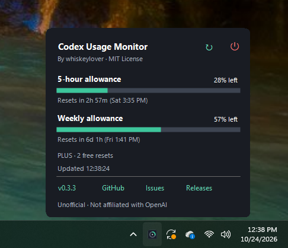

# Codex Usage Monitor

A lightweight Windows tray app for tracking your Codex five-hour and weekly allowances.

**v0.4.3 · Windows x64 · .NET 8 Desktop · [MIT License](LICENSE)**

Hover over or click the teal ring icon in the notification area to open usage.



The compact usage card includes allowance bars, reset countdowns, plan details, and app information.

## Usage

- **Hover** to preview allowances, reset countdowns, and plan details without taking focus.
- **Left-click** to focus the same card and use Refresh. Click away or press Escape to dismiss.
- **Icon actions:** Refresh usage or quit the application. Quit shows a brief shutdown animation; dismissing the card keeps the app running.
- **Footer:** Click the version to copy version information; GitHub, issues, and releases sit alongside it.
- **Right-click** for refresh, diagnostics, automatic-update preferences, and Quit application.

Usage refreshes every two minutes. Starting with Windows is optional during installation and off by default.

## Updates

Automatic checks are enabled by default: shortly after startup when due, then at most once every 24 hours while running. Only newer stable GitHub releases with a Windows x64 installer or ZIP are offered. **Update available** opens the installer download in your browser, falling back to the ZIP for older releases; installation remains manual. Use **Check for updates** in the tray menu to check immediately, even when automatic checks are off or a check ran recently. The card shows the result. Disable scheduled checks with **Check for updates automatically**. Background network failures are silent.

## Setup

Requires Windows 10/11 x64 and the official [Codex CLI](https://github.com/openai/codex) on your PATH. Sign in using `codex login`.

The [release installer](https://github.com/whiskeylover/codex-usage-monitor/releases) installs for your Windows user without administrator privileges, under `%LOCALAPPDATA%\Programs\Codex Usage Monitor`. It bundles .NET and offers daily update checks (on by default), startup at sign-in (off by default), and launch on completion. Uninstall through Windows **Installed apps**. Preferences and diagnostic files remain in `%LOCALAPPDATA%\codex-usage-monitor`.

Alternatively, use the portable ZIP or build from source below; these require the [.NET 8 Desktop Runtime](https://dotnet.microsoft.com/en-us/download/dotnet/8.0). Run `publish\codex-usage-monitor.exe` after building. Exit before replacing files; delete the portable app folder to uninstall.

## Build

Install the .NET 8 SDK, then run from the repository root:

```powershell
powershell.exe -NoProfile -ExecutionPolicy Bypass -File .\build.ps1
.\publish\codex-usage-monitor.exe
```

The app is unsigned, so Windows SmartScreen may show “Windows protected your PC.” If you trust the executable, choose **More info → Run anyway**. On managed PCs, this option may be unavailable. The build command above bypasses PowerShell’s script execution policy for that process only; it does not bypass SmartScreen.

## Release packaging

Pushing a version tag matching the project version builds and tests a portable ZIP, a self-contained Inno Setup installer, and SHA-256 checksums, then publishes them to GitHub Releases. Setup and uninstall smoke tests run before publication.

To package locally with .NET 8 SDK and Inno Setup 6 installed:

```powershell
powershell.exe -NoProfile -ExecutionPolicy Bypass -File .\release.ps1
```

Outputs are placed in `release/`: the portable ZIP, Setup EXE, and checksums. Use `-ZipOnly` to build only the ZIP, or `-IsccPath` to specify an Inno compiler location. The app and installer are unsigned.

## Privacy

- **No telemetry or analytics.** No usage data is sent to a developer-operated server.
- **Your credentials stay with Codex CLI.** The app does not read, copy, or store your authentication files or tokens.
- **Local usage integration.** Usage is requested through the official local `codex app-server`; Codex CLI may contact OpenAI to retrieve it.
- **GitHub update checks.** For automatic checks when enabled, or when you choose **Check for updates**, the app directly requests public release metadata from `api.github.com`. GitHub receives your IP address and a User-Agent containing the app name and version. No Codex credentials, account details, allowance data, or diagnostics are included. No GitHub account or token is required. Clicking download or footer links opens GitHub in your browser.
- **Local preferences and cache.** The last check attempt and available-release details are stored in `%LOCALAPPDATA%\codex-usage-monitor\updates.json`, alongside a cached update preference. Setup stores your update choice in `HKCU\Software\whiskeylover\CodexUsageMonitor`; changes in the app keep it synchronized. Turning off automatic checks prevents future requests; an in-flight request may already have reached GitHub.
- **Optional autostart.** Setup writes a startup entry for your user only if selected. Uninstall removes that entry; it does not change Codex CLI or its login.
- **Local diagnostics only.** Logs stay on your PC unless you choose to share them.

## Troubleshooting

If usage is unavailable, check `codex --version` and `codex login`, then try **Refresh now** and **Open diagnostics**. Logs are stored at `%LOCALAPPDATA%\codex-usage-monitor\diagnostics.log`; review them before sharing.

Unofficial community project; not affiliated with OpenAI. Issues and pull requests are welcome.
